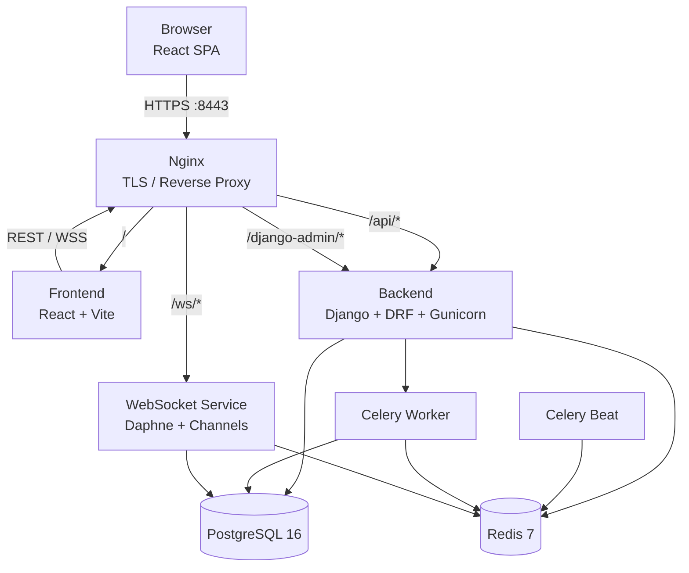
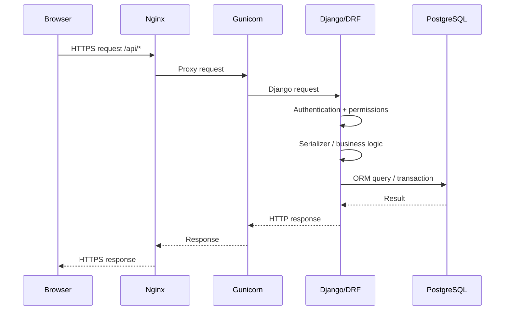
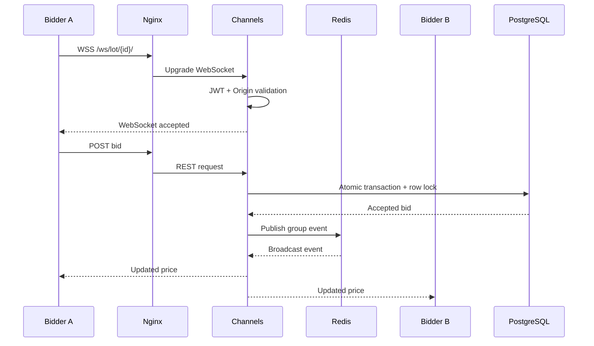
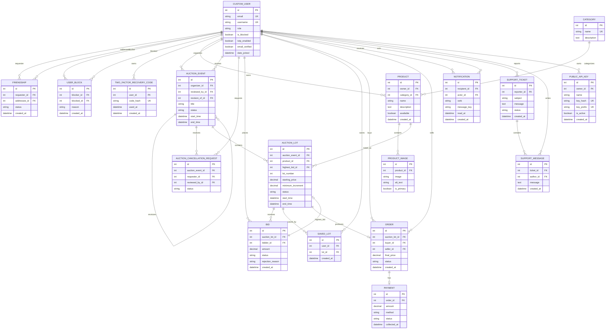
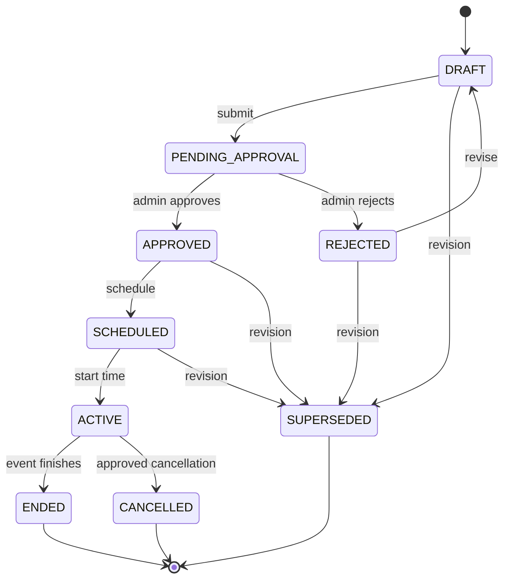
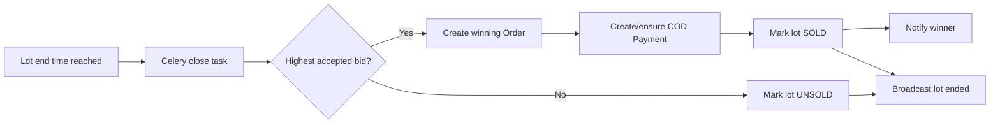

*This project has been created as part of the 42 curriculum by rabusala, balhamad, tabuayya, mamsameh.*

# Mystery Auctions

## Table of Contents

- [Description](#description)
- [Team Information](#team-information)
- [Project Management](#project-management)
- [Technical Stack](#technical-stack)
- [System Architecture](#system-architecture)
- [Database Schema](#database-schema)
- [Auction Lifecycle](#auction-lifecycle)
- [Real-Time Bidding](#real-time-bidding)
- [Features List](#features-list)
- [Modules and Points](#modules-and-points)
- [Individual Contributions](#individual-contributions)
- [Instructions](#instructions)
- [Challenges and Solutions](#challenges-and-solutions)
- [Resources and AI Usage](#resources-and-ai-usage)

---

## Description

**Mystery Auctions** is a secure, multi-user web auction platform developed as part of the `ft_transcendence` project of the 42 Common Core.

The platform allows users to publish products and create timed auction events. Submitted events are reviewed by administrators before they can become active. Once an auction is live, multiple bidders can compete for the same lot concurrently. Bids are validated on the server and protected by PostgreSQL transactions and row-level locking. Accepted bids are propagated to connected clients through WebSockets without requiring a page refresh.

When a lot reaches its end time, the highest accepted bid becomes the winning bid and the system creates a corresponding order. The project uses **cash on delivery** rather than third-party card payment processing.

### Key Features

- Secure registration, email verification, login, refresh and logout.
- JWT authentication using Secure, HttpOnly cookies.
- TOTP two-factor signup and login authentication .
- USER and ADMIN roles with ownership and moderation rules.
- User profiles, avatars, friendships, blocking and online presence.
- Direct user interaction through user-to-user and user-to-administrator chat.
- Product catalog with categories and product images.
- Auction event creation, submission, approval, rejection, scheduling, activation and cancellation.
- Collaborative auction creation and cancellation workflows with live status updates.
- Timed auction lots with minimum bid increments.
- Atomic bid placement with PostgreSQL row locking.
- Rejected-bid auditing with explicit rejection reasons.
- Real-time public browse and lot WebSockets.
- Authenticated WebSocket streams for user-specific events.
- Background lifecycle processing using Celery and Celery Beat.
- Automatic lot closing and winning-order creation.
- Cash-on-delivery order confirmation and seller fulfillment workflow.
- Saved lots and persistent notifications.
- Support tickets and support messages.
- Seller and administrator analytics.
- Search and filtering for friends, auctions and administrator category views.
- Versioned public API protected by hashed API keys and throttling.
- OpenAPI documentation through Swagger UI and Redoc.
- Responsive React frontend with a custom design system, reusable UI components, shared color tokens, typography and icons.
- Privacy Policy and Auction Rules pages.
- HTTPS/WSS through Nginx.

### Project Goal

The goal of the project is to demonstrate a complete web application combining:

1. Secure user management.
2. Relational database design.
3. REST API development.
4. Real-time WebSocket communication.
5. Transaction-safe concurrent bidding.
6. Background task processing.
7. Role-based authorization.
8. Containerized deployment over HTTPS.

---

## Team Information

### Raneem Abusalah (`rabusala`)

**Role:** Technical Lead / Architect, Developer

**Responsibilities:**

- Django and backend architecture.
- Docker, Nginx and HTTPS infrastructure.
- Redis and Django Channels infrastructure.
- Authentication and JWT cookie handling.
- Two-factor authentication.
- Roles and permissions.
- Deployment and integration.
- Backend reviews.

### Bushra Alhamadanii (`balhamad`)

**Role:** Project Manager (PM) / Scrum Master, Catalog and Auction Workflow Developer

**Responsibilities:**

- Product and category functionality.
- Product images.
- Auction events and auction lots.
- Event submission workflow.
- Administrator approval and rejection workflow.
- Ownership and lifecycle validation.

### Tasnim Abuayyash (`tabuayya`)

**Role:** Bidding and Sales Engine Developer

**Responsibilities:**

- Bid validation and rejected-bid auditing.
- Transaction-safe concurrent bidding.
- Minimum-increment rules.
- Automatic lot closure.
- Winning-order creation.
- Cash-on-delivery fulfillment.
- Analytics and operational backend functionality.
- Related backend testing.

### Malak Msameh (`mamsameh`)

**Role:** Product Owner (PO), Frontend Developer

**Responsibilities:**

- React/Vite frontend.
- Buyer, seller and administrator interfaces.
- REST API integration.
- Live bidding interface.
- WebSocket client behavior and reconnection.
- Notifications and frontend validation.
- Privacy Policy and Terms of Service pages.
- Responsive UI.
- Feature implimintation and generation.

---

## Project Management

The project was organized around clear ownership of backend domains and frontend integration.

### Work Organization

The implementation workflow followed these stages:

1. Review the subject requirements and module options.
2. Review the existing project structure.
3. Define backend domain boundaries and database relationships.
4. Implement authentication, permissions and infrastructure.
5. Implement catalog and auction lifecycle functionality.
6. Implement transaction-safe bidding and sales logic.
7. Add real-time WebSocket communication.
8. Integrate the React frontend with REST and WebSocket APIs.
9. Integrate analytics and supporting functionality.
10. Perform integration and submission checks.

### Collaboration and Version Control

- **Git/GitHub:** Used for source control, branches, commits and integration.
- **Project documentation:** Used as a reference for implementation and coordination.
- **Backend contract documentation:** Used to coordinate frontend/backend API expectations.
- **Progress tracking:** Used to follow implementation progress and outstanding work.

### Communication Channels

- **Urgent Coordination (Slack):** Slack served as the primary platform for technical discussions, including architecture alignment, code review, Docker configuration troubleshooting, backend API coordination, and deployment-related decisions.
- **Technical Communication (WhatsApp):** WhatsApp was used for time-sensitive communication, including urgent blocker notifications, quick team updates, and coordinating last-minute changes to meetings and schedules.
- **Last commits (Instegram):** Instegram was used to inform each other of the last changes , modifications , additions and removal of features and the last commit of the last version of the project.

---

## Technical Stack

### Frontend

| Technology | Version | Purpose |
|---|---:|---|
| React | 18.3.1 | Component-based user interface |
| React DOM | 18.3.1 | Browser rendering |
| React Router | 6.26.2 | Client-side routing |
| Vite | 5.4.6 | Frontend development and build tooling |
| Node.js | 22 | Frontend Docker build/runtime |

The frontend is implemented using **JavaScript/JSX**.

### Backend

| Technology | Version | Purpose |
|---|---:|---|
| Python | 3.12 | Backend runtime |
| Django | 6.0.7 | Web framework, ORM, migrations and administration |
| Django REST Framework | 3.18.0 | REST API, serializers, permissions and validation |
| Django Channels | 4.3.2 | WebSocket and ASGI support |
| Daphne | 4.2.3 | ASGI/WebSocket server |
| Gunicorn | 26.0.0 | HTTP application server |
| Celery | 5.6.3 | Background jobs |
| Celery Beat | 5.6.3 | Periodic task scheduling |
| SimpleJWT | 5.5.1 | JWT authentication |
| drf-spectacular | 0.30.0 | OpenAPI documentation |
| pyotp | 2.10.0 | TOTP two-factor authentication |
| qrcode | 8.2 | QR-code generation for 2FA |
| Pillow | 12.3.0 | Image handling |

### Database and Infrastructure

| Technology | Version | Purpose |
|---|---:|---|
| PostgreSQL | 16 | Relational database and transactional locking |
| Redis | 7 Alpine | Channels fan-out and Celery broker/result backend |
| Nginx | 1.27 Alpine | HTTPS termination and reverse proxy |
| Docker Compose | v2 | Multi-container orchestration |

### Why These Technologies?

**React + React DOM** provide the component-based frontend architecture and browser rendering required to build the interactive buyer, seller and administrator interfaces.

**React Router** provides client-side routing, allowing the application to manage multiple pages and role-specific views without full browser reloads.

**Vite** provides a fast frontend development environment and production build tooling for the React application.

**JavaScript/JSX** is used to implement the frontend logic, reusable React components, user interactions, form handling, client-side validation and integration with backend services.

**REST API integration** allows the React frontend to communicate with the Django REST Framework backend for authentication, products, auctions, bids, orders, notifications and other application data.

**WebSockets** provide real-time communication between the frontend and backend, allowing live bid updates, auction status changes and real-time notifications to appear without requiring page refreshes.

**Node.js** provides the frontend build/runtime environment used by the Vite-based application and its Docker container.

**Django + Django REST Framework** provide the backend framework, ORM, migrations, authentication integration, API development, administrative functionality, validation and permissions.

**PostgreSQL** provides the transactional guarantees and row-level locking required to safely handle concurrent bids.

**Django Channels + Redis** provide persistent WebSocket connections and real-time event distribution between connected clients and backend processes.

**Celery + Celery Beat** allow auction lifecycle operations and scheduled tasks to run independently of browser requests.

**Nginx** acts as the public entry point, providing HTTPS termination and routing requests to the frontend, REST backend and WebSocket service.

---

## System Architecture

The application is deployed as multiple Docker Compose services.



### HTTP Request Flow



### Real-Time Flow



---

## Database Schema

The current Django models form the database structure used by the application.

### Main Entities

- `accounts`: `CustomUser`, `Friendship`, `UserBlock`, `TwoFactorRecoveryCode`
- `products`: `Category`, `Product`, `ProductImage`
- `auctions`: `AuctionEvent`, `AuctionCancellationRequest`, `AuctionLot`, `Bid`, `SavedLot`
- `orders`: `Order`, `Payment`
- `notifications`: `Notification`, `SupportTicket`, `SupportMessage`
- `common`: `PublicApiKey`

### Entity Relationship Diagram



### Database Relationships and Constraints

The application enforces relationships and constraints including:

- Unique email addresses and usernames.
- Users cannot create friendships with themselves.
- Users cannot block themselves.
- Duplicate friendship pairs are prevented.
- A saved lot cannot be duplicated for the same user.
- Lot numbers are unique within an auction event.
- Starting prices and minimum increments must be positive.
- Auction event and lot end times must be after their start times.
- A sold lot produces at most one order.
- An order has at most one payment record.
- Bid updates use transactions and row-level locking.

---

## Auction Lifecycle



### Lot Closing Flow



---

## Real-Time Bidding

The browser does not decide the winner.

A bid follows this sequence:

1. The client sends a bid request.
2. The backend authenticates the user.
3. The server loads the target lot inside a transaction.
4. The lot row is locked using PostgreSQL row-level locking.
5. The server re-checks the current state while holding the lock.
6. The bid is accepted only if the auction is active and the amount satisfies the minimum increment.
7. The highest-bid reference is updated atomically.
8. Rejected bids are recorded with a reason.
9. A real-time event is published through Channels and Redis.
10. Connected clients update their displayed price without refreshing.

This prevents simultaneous clients from successfully becoming the highest bidder based on the same stale database state.

---

## Features List

| Feature | Description | Contributor(s) |
|---|---|---|
| Authentication | Registration, verification, login, refresh, logout and password workflows | `rabusala` |
| Two-factor authentication | TOTP enrollment, verification and recovery codes | `balhamad` |
| User profiles | Profiles, avatars, presence and account controls | `mamsameh` |
| Friend system | Friend requests, acceptance/decline and removal | `rabusala`, `mamsameh` |
| User interaction | User-to-user and user-to-administrator chat, profiles and friends | `mamsameh`, `balhamad`, `tabuayya` |
| Blocking | User-to-user blocking and administrative controls | `rabusala` |
| Catalog | Categories, products and product images | `balhamad` |
| Auction moderation | Event/lot creation, submission, approval, rejection and scheduling | `balhamad` |
| Auction collaboration | Live auction creation and cancellation status updates | `mamsameh`, `rabusala`, `balhamad`, `tabuayya` |
| Bidding engine | Minimum increment validation, rejected-bid auditing and concurrency protection | `mamsameh`, `rabusala` |
| Live bidding | Public browse/lot WebSockets and live price propagation | `mamsameh`, `rabusala`, `balhamad`, `tabuayya` |
| Auction closure | Scheduled closure and winning-order generation | `mamsameh`, `rabusala` |
| Orders | Winner checkout, COD confirmation, cancellation and fulfillment | `tabuayya` |
| Notifications | Persistent user notifications and real-time delivery | `balhamad`, `mamsameh` |
| Support | Support tickets, messages and administrator support workflow | `mamsameh`, `balhamad`, `tabuayya` |
| Analytics | Seller and administrator analytics | `rabusala` |
| Search and filtering | Friend search, auction search and administrator category filtering | `mamsameh` |
| Public API | API-key authentication, throttling and documented endpoints | `rabusala`, `tabuayya` |
| Frontend | Buyer, seller and administrator interfaces | `mamsameh` |
| Infrastructure | Docker, PostgreSQL, Redis, Celery and Nginx/HTTPS | `rabusala` |

---

## Modules and Points

| Category | Module | Type | Points | Implementation |
|---|---|---|---:|---|
| Web | Frontend and backend frameworks | Major | 2 | React/Vite frontend with Django/DRF backend |
| Web | Real-time features | Major | 2 | Django Channels, Daphne and Redis-backed WebSockets |
| Web | User interaction | Major | 2 | User-to-user and user-to-administrator chat, profiles and friends |
| Web | Public API | Major | 2 | Versioned API, hashed API keys, throttling and OpenAPI documentation |
| Web | ORM | Minor | 1 | Django ORM, migrations, constraints and relational queries |
| Web | Notification system | Minor | 1 | Persistent and real-time notifications for friend requests, auction closure, winners and other user events |
| Web | Real-time collaboration | Minor | 1 | Live auction creation and cancellation workflows with shared status updates |
| Web | Advanced search and filtering | Minor | 1 | Friend search, auction search and category filtering in the administrator workspace |
| User Management | Standard user management | Major | 2 | Profiles, avatars, friendships, presence and account controls |
| User Management | Advanced permissions | Major | 2 | USER/ADMIN roles, ownership rules and moderation permissions |
| User Management | Two-factor authentication | Minor | 1 | TOTP setup, verification and recovery-code workflows |
| Data & Analytics | Analytics dashboard | Major | 2 | Database-backed analytics |
| Web | Custom-made design system | Minor | 1 | Shared color palette, typography, icons and 10 reusable UI components in the React frontend |

**Verified total: 20 points**

### Reusable UI component verification

The submitted frontend archive was inspected to verify the custom design-system requirement. It contains **10 reusable UI components** that are imported and used by at least two different source files:

`Layout`, `SiteFooter`, `Logo`, `SplashScreen`, `AuctionCard`, `AuctionModal`, `RouteLoading`, `ChevronLeft`, `ChevronRight` and `CloseIcon`.

The components share the frontend design tokens and styles defined in `frontend/src/styles/theme.css` and `frontend/src/styles/components.css`. The icon components are exported from `frontend/src/components/Icons.jsx`; they are counted individually because they are independently reusable React components.

### Module Justification

#### Frontend and Backend Frameworks — Major, 2 points

React provides the interactive client application while Django and Django REST Framework provide the server-side application, REST API, validation, permissions and ORM.

#### Real-Time Features — Major, 2 points

Live auctions require multiple connected clients to see bid changes without page refreshes. Django Channels provides WebSocket consumers and Redis provides cross-process channel-layer communication.

#### User Interaction — Major, 2 points

The application includes user profiles, friendships and direct chat between users. The support workflow also provides interaction between users and administrators through tickets and messages.

#### Standard User Management — Major, 2 points

The platform provides persistent accounts, profiles, avatars, presence, friendships and account-management workflows.

#### Advanced Permissions — Major, 2 points

Authorization is enforced beyond authentication. USER and ADMIN roles have different capabilities, while ownership and moderation rules are enforced server-side.

#### Analytics Dashboard — Major, 2 points

Analytics functionality provides database-backed metrics for seller and administrator views.

#### Public API — Major, 2 points

The project provides a versioned public API protected by API keys. Keys are stored as hashes, requests are throttled and the API is documented using OpenAPI.

#### ORM — Minor, 1 point

Database access is implemented through Django's ORM, models, migrations, relationships, constraints and QuerySets.

#### Two-Factor Authentication — Minor, 1 point

The accounts system supports TOTP setup and verification, QR enrollment and recovery codes.

#### Notification System — Minor, 1 point

Notifications are persisted for user events such as friend requests, auction completion and winning bids, and are delivered to the frontend in real time where applicable.

#### Real-Time Collaboration — Minor, 1 point

Auction creation and cancellation workflows expose shared, live status changes so users and administrators can work with the same current auction state.

#### Advanced Search and Filtering — Minor, 1 point

Users can search for friends and auctions, while the administrator workspace provides category and related data filters.

#### Custom-Made Design System — Minor, 1 point

The React frontend uses a shared color palette, typography rules, icon set and reusable components instead of rebuilding the same interface controls on each page. The archive verification found 10 independently reusable UI components, satisfying the minimum requirement.

---

## Individual Contributions

### Raneem Abusalah (`rabusala`)

**Features and modules:**

- Authentication: registration, verification, login, refresh, logout and password workflows.
- Friend system.
- Blocking.
- Auction collaboration.
- Live bidding.
- Auction closure.
- Analytics.
- Public API.
- Infrastructure.

**Main components:**

- Authentication and account-management workflows.
- Friend-system and blocking controls.
- Auction collaboration and auction-closure backend workflows.
- Live-bidding and WebSocket infrastructure.
- Seller and administrator analytics.
- API-key authentication, throttling and documented public API endpoints.
- Docker, PostgreSQL, Redis, Celery and Nginx/HTTPS configuration.

### Bushra Alhamadanii (`balhamad`)

**Features and modules:**

- Two-factor authentication.
- User interaction.
- Catalog.
- Auction moderation.
- Auction collaboration.
- Live bidding.
- Notifications.
- Support.

**Main components:**

- Two-factor authentication integration.
- User-to-user and user-to-administrator interaction workflows.
- Product, category and product-image models and APIs.
- Auction event and lot creation workflows.
- Event submission and administrator approval/rejection workflow.
- Auction collaboration and live-bidding integration.
- Persistent notifications and administrator support workflow.

### Tasnim Abuayyash (`tabuayya`)

**Features and modules:**

- User interaction.
- Auction collaboration.
- Live bidding.
- Orders.
- Support.
- Public API.

**Main components:**

- User-to-user and user-to-administrator interaction workflows.
- Auction collaboration and live-bidding integration.
- Winner checkout, order and cash-on-delivery workflows.
- Support tickets, messages and administrator support workflow.
- API-key authentication, throttling and documented public API endpoints.

### Malak Msameh (`mamsameh`)

**Features and modules:**

- User profiles.
- Friend system.
- User interaction.
- Auction collaboration.
- Bidding engine.
- Live bidding.
- Auction closure.
- Notifications.
- Support.
- Search and filtering.
- Frontend.

**Main components:**

- User profiles, avatars, presence and account controls.
- Friend requests, acceptance/decline and removal.
- User-to-user and user-to-administrator chat interfaces.
- Auction creation, cancellation and live-status interfaces.
- Bidding validation and rejected-bid display.
- Public browse, lot and live-bidding interfaces.
- Auction-ended and winning-order interfaces.
- Notifications and support interfaces.
- Friend search, auction search and administrator filtering.
- React components, pages, client-side routing and API integration.

---

## Instructions

### Prerequisites

Before running the project, make sure the following are installed and available:

- **Docker Desktop** with Docker Compose support.
- **Git**.
- **Google Chrome** or another modern web browser. Chrome is recommended for evaluation.
- **Node.js 22** is only required if the frontend is developed or run directly outside Docker.

The normal project setup is fully containerized. PostgreSQL, Redis, Django, Celery, Daphne, Nginx and the React application are provided through Docker Compose and therefore do not need to be installed separately on the host machine.

Make sure **Docker Desktop is running** before starting the project.

### 1. Clone the Repository

Clone the repository and enter the project directory:

```bash
git clone <repository-url>
cd transendence_2
```

### 2. Build and Start the Project

From the project root, build and start the complete application:

```bash
docker compose up --build
```

This command builds the project images and starts the complete Docker Compose environment.

The application consists of the following services:

| Service | Purpose |
|---|---|
| `db` | PostgreSQL 16 database |
| `redis` | Redis 7 for Channels, caching and Celery |
| `backend` | Django REST API served by Gunicorn |
| `websocket` | Django Channels WebSocket service served by Daphne |
| `worker` | Celery background worker |
| `beat` | Celery periodic task scheduler |
| `frontend` | React frontend |
| `nginx` | HTTPS/WSS reverse proxy and public entry point |

The services communicate through the Docker network and use persistent volumes for database, Redis and media data.

### 3. Wait for the Services to Start

After running:

```bash
docker compose up --build
```

wait for the containers to finish building and start.

In a second terminal, from the project directory, check the running services:

```bash
docker compose ps
```

The Docker Compose environment should contain the project services for the database, Redis, backend, WebSocket server, Celery worker, Celery Beat, frontend and Nginx.

If a service fails to start, inspect its logs:

```bash
docker compose logs
```

or follow the logs live:

```bash
docker compose logs -f
```

### 4. Open the Application

Once the services are running, open **Google Chrome** and enter:

```text
https://localhost:8443/
```

The application is served through Nginx over HTTPS.

The project uses a local development certificate. Because this certificate is self-signed, Chrome may display a security warning.

For local evaluation, accept the certificate warning and continue to:

```text
https://localhost:8443/
```

The React application should then load in the browser.

### 5. Use the Application

After the application loads:

1. Open the registration page.
2. Create a user account.
3. Complete the authentication flow.
4. Log in to the application.
5. Use the available role-specific functionality.
6. Sellers can create products and auction events.
7. Auction events can be submitted for administrator review.
8. An administrator can approve or reject submitted auction events.
9. Once an auction is active, bidders can open the lot and place bids.
10. Live bid updates are delivered through the WebSocket connection without refreshing the page.
11. When a lot closes, the winning bid is used to create the corresponding order.
12. The order follows the project's cash-on-delivery workflow.

### 6. Access the API Documentation

The project provides OpenAPI documentation through Swagger UI and Redoc.

Swagger UI:

```text
https://localhost:8443/api/docs/swagger/
```

Redoc:

```text
https://localhost:8443/api/docs/redoc/
```

These interfaces can be used to inspect and interact with the documented API endpoints.

### 7. Check Application Readiness

The backend readiness endpoint is available at:

```text
https://localhost:8443/api/health/ready/
```

A successful readiness response indicates that the backend is available through the Nginx entry point.

### 8. Django Administration

The React administrator workspace is available at:

```text
https://localhost:8443/admin
```

The Django technical administration interface is available at:

```text
https://localhost:8443/django-admin/
```

The two interfaces serve different purposes: the React administrator workspace is part of the platform, while Django administration is intended for technical/backend administration.

### 9. Backend Verification

With the containers running, open another terminal in the project directory and run:

```bash
docker compose exec backend python manage.py check
```

Run the backend tests:

```bash
docker compose exec backend python manage.py test apps
```

Check that no migrations are missing:

```bash
docker compose exec backend python manage.py makemigrations --check --dry-run
```

### 10. Makefile Shortcuts

The repository also provides a Makefile with convenience commands:

```bash
make
make run
make down
make restart
make logs
make ps
make check
make test
make migrate
make seed
make clean
make fclean
make re
```

The Makefile is a convenience layer; the underlying application is Docker Compose based.

### 11. Stop the Project

To stop the running containers:

```bash
docker compose down
```

This stops the containers while preserving the Docker volumes.

To completely remove the project's Docker resources, use the appropriate cleanup target provided by the Makefile:

```bash
make clean
```

or:

```bash
make fclean
```

Use the full cleanup targets with care because they may remove persistent project resources.
---

## Challenges and Solutions

### Concurrent Bidding

**Challenge:** Two bidders may submit bids at almost exactly the same time. A naive read-modify-write sequence could allow stale state to determine the winner.

**Solution:** Bid placement is protected by a database transaction and row-level locking. The current lot state is re-read while the lock is held before accepting the bid.

### Real-Time Synchronization

**Challenge:** The displayed price must remain synchronized across multiple browser sessions without polling or page refreshes.

**Solution:** Django Channels provides WebSocket consumers and Redis provides the channel layer used to broadcast events across service processes.

### Time-Based Auction Closure

**Challenge:** A lot must close even when no browser is currently connected to it.

**Solution:** Celery and Celery Beat execute background lifecycle tasks independently of browser traffic.

### WebSocket Authentication

**Challenge:** WebSocket connections require authentication while the application uses JWT-based authentication.

**Solution:** The ASGI stack uses JWT authentication middleware and origin validation before protected WebSocket consumers are allowed to operate.

### Frontend and Backend State Synchronization

**Challenge:** The frontend must accurately represent server-side auction, order and notification state while asynchronous events are received.

**Solution:** The frontend uses initial REST state followed by WebSocket updates and explicit loading, error and auction-ended states.

---

## Resources and AI Usage

### Documentation and References

- [Django Documentation](https://docs.djangoproject.com/)
- [Django REST Framework Documentation](https://www.django-rest-framework.org/)
- [Django Channels Documentation](https://channels.readthedocs.io/)
- [PostgreSQL Documentation](https://www.postgresql.org/docs/)
- [Celery Documentation](https://docs.celeryq.dev/)
- [React Documentation](https://react.dev/)
- [Vite Documentation](https://vite.dev/guide/)
- [Docker Documentation](https://docs.docker.com/)
- [Docker Compose Documentation](https://docs.docker.com/compose/)
- [OWASP Authentication Cheat Sheet](https://cheatsheetseries.owasp.org/cheatsheets/Authentication_Cheat_Sheet.html)

### AI Usage

AI tools were used as development assistance for:

- Understanding project and subject requirements.
- Explaining unfamiliar framework concepts.
- Reviewing architecture and implementation approaches.
- Generating and improving test ideas.
- Diagnosing Docker and runtime errors.
- Reviewing concurrency and WebSocket behavior.
- Drafting and refining project documentation.

AI-generated output was not treated as proof of correctness. The team remained responsible for understanding the implementation, reviewing generated suggestions, running the code and validating the resulting behavior.
